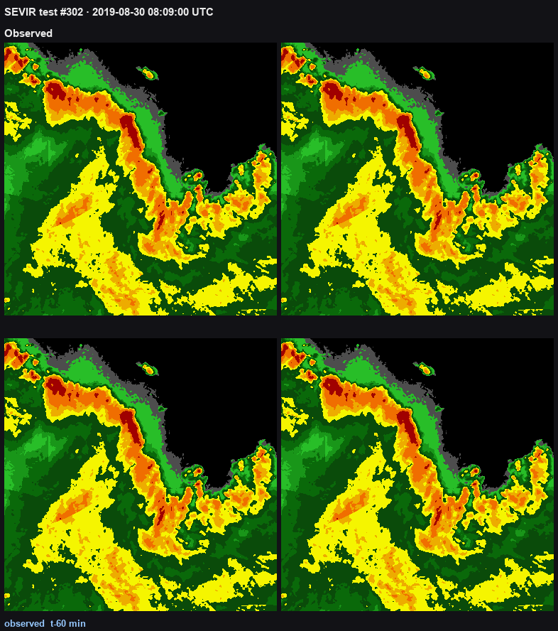
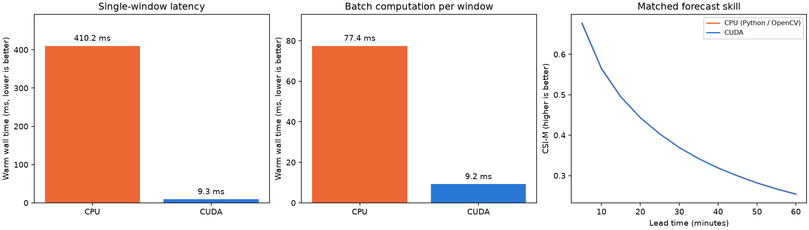
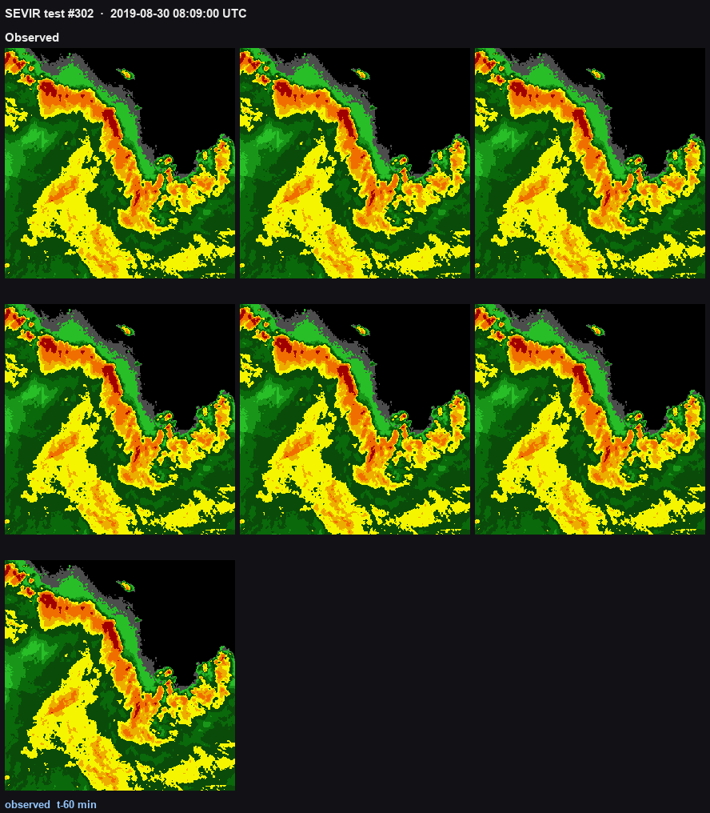
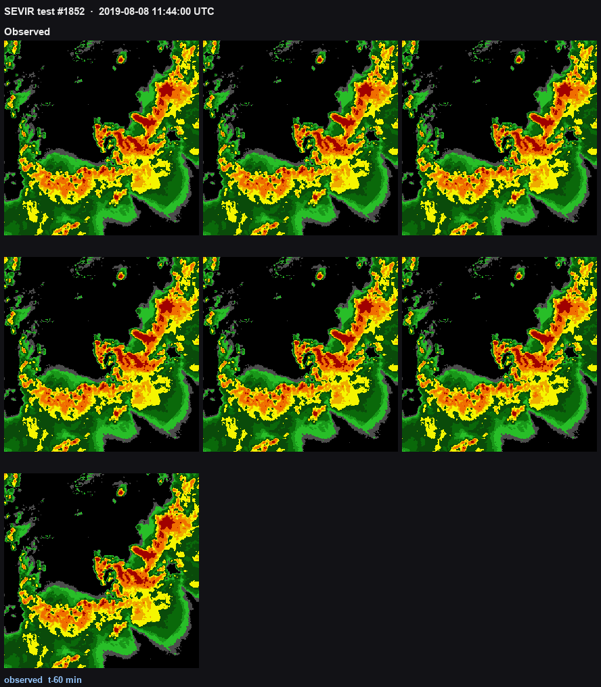
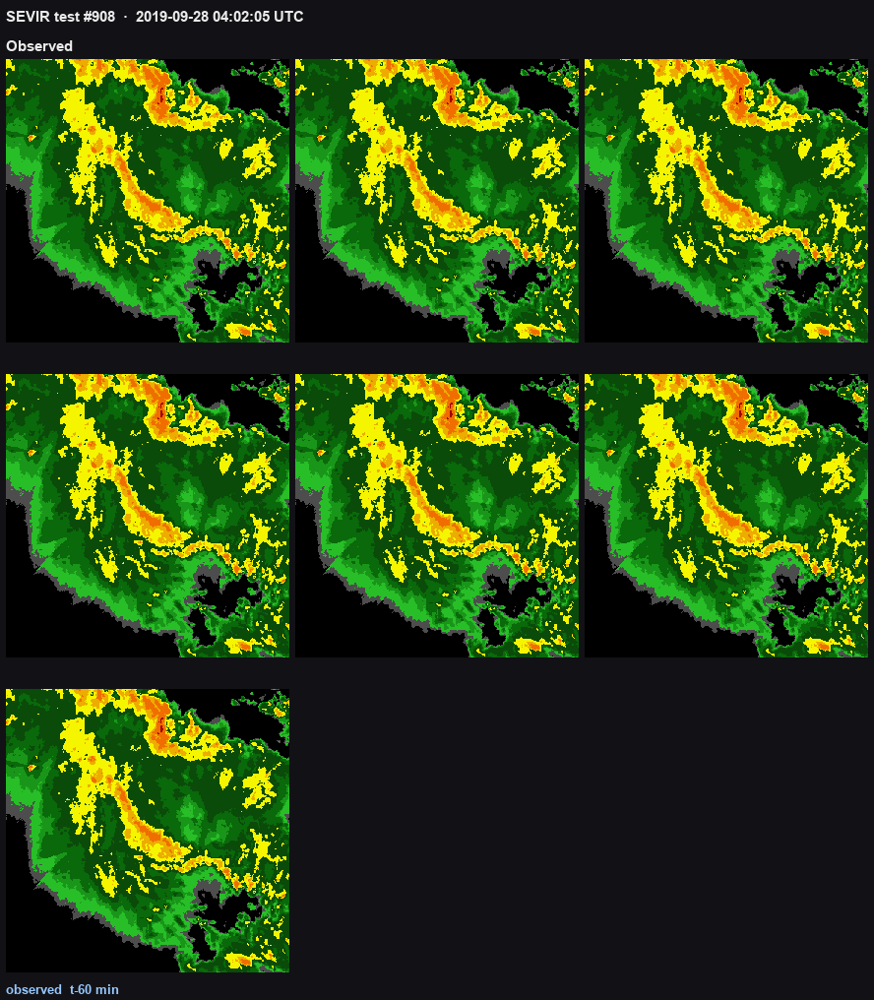
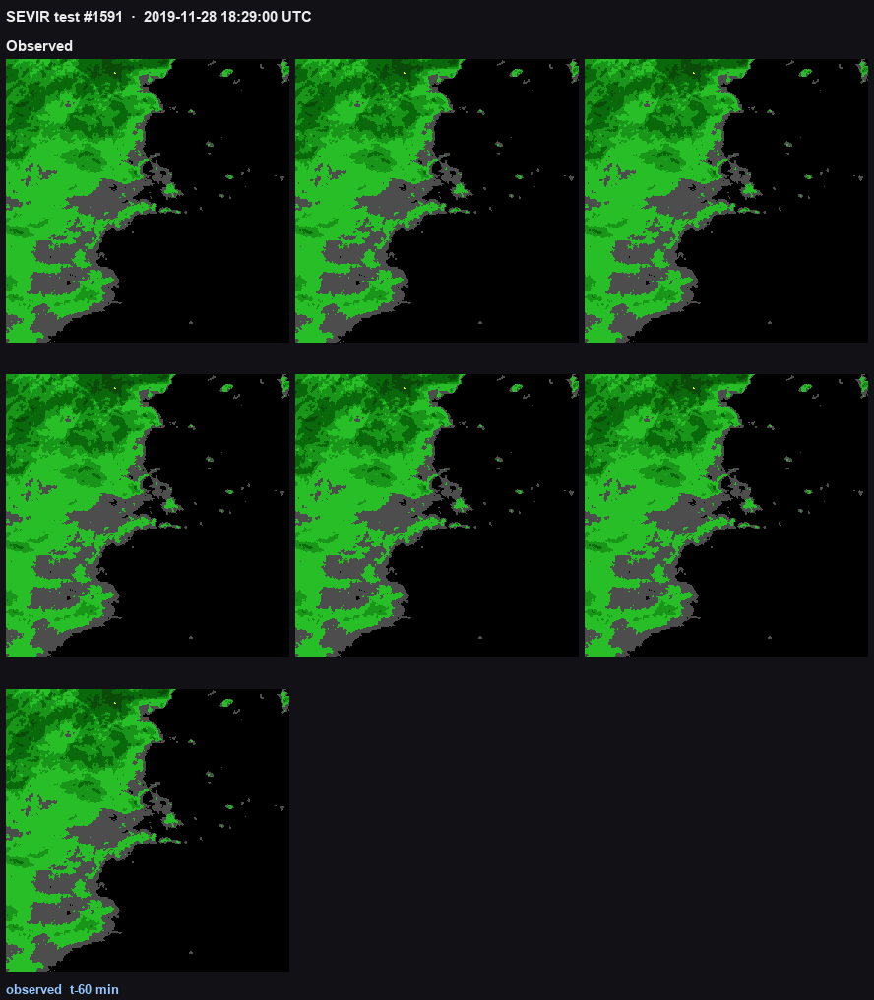
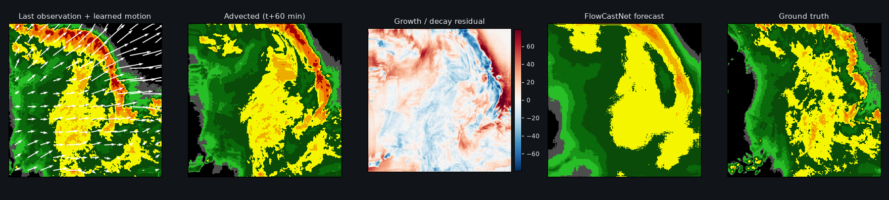

# FlowCast: classical, CUDA and learned radar forecasts

Compare classical optical flow, a native CUDA implementation, and machine learning on the same storms.
Given 13 radar observations, each method predicts the next 12 frames: a one-hour forecast.

**Classical motion estimation · GPU acceleration · FlowCastNet learned forecasts · 1,872 test windows**



*Top: ground truth and FlowCastNet. Bottom: classical CPU optical flow and native CUDA optical flow.
All four panels use the same observations and forecast times. Observations play first, followed by the next hour of forecasts.*

[CPU/CUDA report](report/optical_flow_cuda.md) · [Model results](report/model_comparison.md) ·
[How FlowCastNet works](#how-flowcastnet-builds-a-forecast) · [Reproduce the report](#reproduce-the-report)

## CPU vs CUDA optical flow results

The native CUDA implementation moves motion estimation, confidence weighting, history alignment,
growth/decay, filtering and advection onto the GPU. The CPU version uses Python, NumPy and OpenCV DIS.
Both use the selected multi-gap settings and were evaluated on the same **1,872 official test windows**.

| Implementation | CSI-M ↑ | CSI ≥ 133 ↑ | CSI ≥ 219 ↑ | MSE ×10⁻³ ↓ |
|---|---:|---:|---:|---:|
| CPU (Python / OpenCV) | 0.38343 | 0.35121 | 0.13942 | 5.75543 |
| CUDA | 0.38309 | 0.35054 | 0.13828 | 5.74234 |

| Implementation | Single-window mean | Batch mean per window | Batch throughput |
|---|---:|---:|---:|
| CPU (Python / OpenCV) | 410.23 ms | 77.44 ms | 12.91 windows/s |
| CUDA | 9.26 ms | 9.20 ms | 108.65 windows/s |

CUDA gives **44.3× lower single-window latency** and **8.4× higher batch throughput** on the measured
machine: RTX 5060 Ti, Intel Core i9-12900K, Windows, CUDA 13.1, OpenCV 5.0.0 (November 18, 2026).


<details>
<summary>Timing protocol and hardware</summary>

Warm timing uses 32 fixed test windows with three repeats, with input uploads, forecast/motion downloads
and synchronization included. Disk reads, scoring and initial setup are excluded. Batch calls contain
eight windows; CPU uses eight workers with one OpenCV thread each, while CUDA processes windows
sequentially and parallelizes motion pairs, patches and pixels.

</details>



The parallel CUDA DIS solver produces different local forecasts from OpenCV DIS. Aggregate CSI-M is
slightly lower and MSE slightly lower in this run; these are point estimates without confidence intervals.
See [the measured comparison](report/optical_flow_cuda.md) for output differences and timing details,
and [the CUDA guide](flowcasting_cuda/README.md) for build and benchmark commands.

## Storm forecasts

Each animation shows 65 minutes of observed radar followed by 60 minutes of forecasts, alongside
what the radar actually recorded. Panels compare ground truth, Earthformer, fine-tuned Earthformer,
FlowCastNet, CPU optical flow, CUDA optical flow, and pySTEPS LK. Colors show encoded VIL;
the strongest echoes are red. The comparisons wrap into three columns so each storm stays large enough to inspect.

**Storm A · August 30, 2019 · test window #302**



<details>
<summary>More storm comparisons: Storm B, Storm C, and a moderate event</summary>

**Storm B · August 8, 2019 · test window #1852**



**Storm C · September 28, 2019 · test window #908**



**Moderate event · November 28, 2019 · test window #1591**



</details>

The three strongest cases were selected by ground-truth heavy-echo coverage, with distinct events;
the moderate case was sampled at random. Selection does not depend on which predictor wins.

## How FlowCastNet builds a forecast

FlowCastNet learns a displacement field that moves the last observation forward, plus an intensity
residual for storm growth and decay. This example shows the last observation with learned motion
arrows, the advected field at 60 minutes, the residual, the final forecast and the ground truth.
Storm intensity uses the same palette as the animations; the residual uses a separate blue/red scale
for negative/positive changes.



The model is a ConvNeXt U-Net with a displacement head and an intensity-residual head. Both heads
start at zero, so its initial forecast repeats the last observation. See [model results](report/model_comparison.md)
for the full neural-model comparison. Generate the interactive report locally with `python build_report.py`
after evaluation and figure generation; open `results/report/index.html` for storm selectors and key-frame views.

## Reproduce the report

With the SEVIR data, trained checkpoints and [native CUDA library](flowcasting_cuda/README.md) available:

```powershell
.\.venv\Scripts\python.exe make_figures.py --cuda --readme-assets --models "Earthformer=earthformer-pretrained,Earthformer FT=runs/earthformer_ft/best.pt,FlowCastNet=runs/flowcast/best.pt"
.\.venv\Scripts\python.exe build_report.py
```

Open `results/report/index.html` for the interactive report. `--readme-assets` also refreshes the larger,
three-column animations and illustrations in `report/assets/`. To recompute CPU/CUDA scores and timings,
run `python benchmark_optical_flow_cuda.py` before rebuilding the report. Setup, evaluation and training
details follow below.

## Pysteps optical flow comparison

Install `requirements.txt`, then evaluate the open-source [pysteps](https://pysteps.github.io/)
baseline on the same official SEVIR test set:

```powershell
.\.venv\Scripts\python.exe evaluate.py --methods persistence,optical_flow,pysteps --device cpu
.\.venv\Scripts\python.exe build_report.py
```

Open `results/report/index.html`. Metrics are saved in `results/metrics.json` and
per-window scores in `results/per_sample_pysteps.npz`. Evaluation uses CUDA automatically
when available; `--device cpu` supports machines without CUDA. Use `--limit 8 --out results/smoke`
for a separate smoke run, so partial metrics do not replace full-test results.

The full-test results and method details are recorded in [report/pysteps.md](report/pysteps.md).

## FlowCast Optical Flow

Our deterministic predictor combines OpenCV DIS motion over 10-, 15- and 30-minute gaps,
aligns recent estimates, weights reliable motion, and advects damped growth and multiscale detail.
It uses encoded VIL with no trained weights. The external pySTEPS LK baseline remains unchanged.

```powershell
.\.venv\Scripts\python.exe evaluate.py --methods persistence,optical_flow,pysteps --device cpu
.\.venv\Scripts\python.exe build_report.py
```

Evaluation records the resolved configuration; figures reuse those settings. Optional JSON overrides
use `--optical-flow-config PATH.json`; the selected preset is `configs/optical_flow_v3.json`.
See [implementation and measured comparison](report/optical_flow.md) for selection, results and limitations.

The [native CUDA implementation](flowcasting_cuda/README.md) moves motion estimation and the forecast
pipeline onto the GPU. Build it with xmake, then run `benchmark_optical_flow_cuda.py` and
`build_report.py` for matched Python/CUDA accuracy, transfer-inclusive runtime and forecast figures.
The parallel GPU motion solver is evaluated separately from the OpenCV implementation.

`Pysteps LK` uses pysteps 1.21.5 Lucas–Kanade motion on the last four observations
(the same three recent frame pairs as DIS), followed by deterministic semi-Lagrangian
extrapolation for all 12 leads. Linear interpolation, one midpoint iteration, zero
outside the grid, and rounded uint8 outputs make the settings explicit. It operates
directly on encoded VIL, without conversion to rain rate or a logarithmic transform.
This is an optical flow baseline, not the stochastic STEPS ensemble nowcast.
All methods share the original grid, targets, lead times, thresholds and scoring code.

To include trained models, append `flowcast,earthformer,earthformer_ft` to `--methods`
once their checkpoints are available, then regenerate the figures and report.
The report includes a baseline-only comparison when ML evaluation artifacts are absent.

## GPU model training and comparison

Completed test results are recorded in [report/model_comparison.md](report/model_comparison.md).

With a CUDA-enabled PyTorch installation, train FlowCastNet from scratch and fine-tune
Earthformer using the downloaded training events. These commands use validation CSI-M
to select `best.pt`; the official test windows are evaluated only afterward.

```powershell
.\.venv\Scripts\python.exe train.py --run runs/flowcast --steps 20000 --batch 4 --workers 4 --vram-gb 10 --val-every 1000 --log-every 50 --ckpt-every 500
.\.venv\Scripts\python.exe train.py --run runs/earthformer_ft --arch earthformer --init pretrained --freeze-stem --no-augment --steps 8000 --batch 1 --lr 5e-5 --weight-decay 0 --workers 2 --vram-gb 6 --val-every 1000 --log-every 50 --ckpt-every 500
.\.venv\Scripts\python.exe evaluate.py --methods flowcast,earthformer,earthformer_ft --chunk 1
.\.venv\Scripts\python.exe make_figures.py --models "Earthformer=earthformer-pretrained,Earthformer FT=runs/earthformer_ft/best.pt,FlowCastNet=runs/flowcast/best.pt"
.\.venv\Scripts\python.exe build_report.py
```

The Earthformer initialization file must be at `data/pretrained/earthformer_sevir.pdparams`;
its URL is recorded in `flowcast/earthformer.py`. Install `requirements.txt` for its `einops`
dependency. The training seed defaults to 42, and run configs record the GPU and PyTorch
version. Checkpoints are replaced atomically; add `--resume` to continue an interrupted
run from `last.pt`. Existing baseline scores in `results/metrics.json` are preserved
when evaluating the models. VRAM caps are per process; adjust them to your GPU.

To resume both configured runs and then automatically evaluate, render figures, and
rebuild the report, run `python run_comparison.py`. It reads each run's existing
`config.json`, skips completed training schedules, and records its current stage in
`logs/comparison_status.json`. Per-stage output is in `logs/comparison_<stage>.log`.
Only one runner can run at a time. The computer must remain awake; rerun the same
command after an interruption to continue from the saved checkpoints.

## Pipeline

```powershell
python download_sevir_test.py                  # official test set: 1,872 windows, Jun-Nov 2019 (5 GB)
python download_sevir_train.py --budget-gb 40  # raw VIL training events (resumable byte-range fetch)
bash train_supervised.sh --run runs/flowcast --steps 20000 --duty 0.75 --vram-gb 2.5
python evaluate.py                             # metrics for persistence, optical flow and FlowCastNet
python rollout.py                              # 3-hour autoregressive simulation on held-out events
python make_figures.py                         # figures and animations in results/figures
python build_report.py                         # self-contained report in results/report
```

**Training data.** `download_sevir_train.py` reads the SEVIR catalog and selects every storm event plus a
random sample of "random" events dated before 2019-06-01, so nothing overlaps the test period. The raw
SEVIR VIL files store an uncompressed, contiguous `(N, 384, 384, 49)` uint8 array, so each 4-hour event is
fetched with a single HTTP range request instead of downloading whole 10-17 GB files. Events are written
time-first to `data/sevir/vil_train/events.npy` with a manifest (`events.csv`) and an event-level
train/validation split.

**Model.** `flowcast/model.py` is a ConvNeXt U-Net in a 4x space-to-depth latent space. For every lead time it
predicts a displacement field, which advects the latest frame (a learned semi-Lagrangian step), and an
intensity residual for growth and decay. Both heads start at zero, so the untrained model is exactly persistence.

**Shared GPU.** `train.py` caps its own VRAM (`--vram-gb`), can throttle itself (`--duty`), and checkpoints
every `--ckpt-every` steps; `train_supervised.sh` resumes automatically if another process's memory spike
kills a step.

**Metrics.** CSI/POD/SUCC/BIAS are computed from hits, misses and false alarms summed over the whole test set
at the SEVIR thresholds 16, 74, 133, 160, 181 and 219 (CSI-M is their mean), plus max-pooled CSI at 4 and 16 km
and MSE/MAE on 0-1 scaled VIL. These follow the Earthformer convention, so the published numbers are comparable.

## Explore the radar data

Install dependencies and open the interactive viewer in PowerShell:

```powershell
.\.venv\Scripts\python.exe -m pip install -r requirements.txt
.\.venv\Scripts\python.exe view_sevir.py
```

Choose an **Example** (0–1871), then select **Frames** such as `0,3,8`
or `0:12:2` and click **Apply selection**. Ranges exclude the stop index.
Alternatively, enter **N frames** and click **Show first N**.
**Save PNG** saves the current view into `renders/`.

The default dataset, `IN_vil`, contains 13 input radar frames per example.
Change **Dataset** to `OUT_vil` for the corresponding 12 future target frames.
Frame numbers are local to each dataset and start at zero. Colors show encoded
SEVIR values on a fixed 0–255 scale for radar, not rainfall in physical units.
Other available channels are printed at startup; their colors use the minimum
and maximum of the selected frames.

Render six frames, or export a specific selection without opening a window:

```powershell
.\.venv\Scripts\python.exe view_sevir.py --sample 10 -n 6
.\.venv\Scripts\python.exe view_sevir.py --sample 10 --frames 0,3,8,12 --output renders/example10.png
.\.venv\Scripts\python.exe view_sevir.py --dataset OUT_vil --sample 10 --frames 0:12 --output renders/targets10.png
```

Use `--file PATH` for another HDF5 file with datasets shaped
`(examples, height, width, frames)` and `--columns N` to change the grid layout.
Only selected frames are read into memory. The viewer limits grids to 64 frames.
